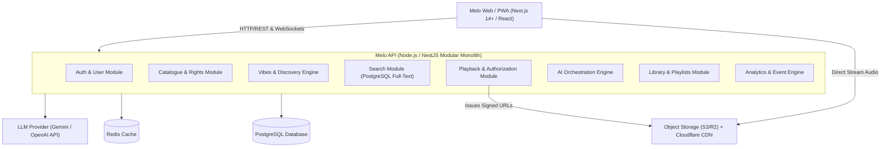
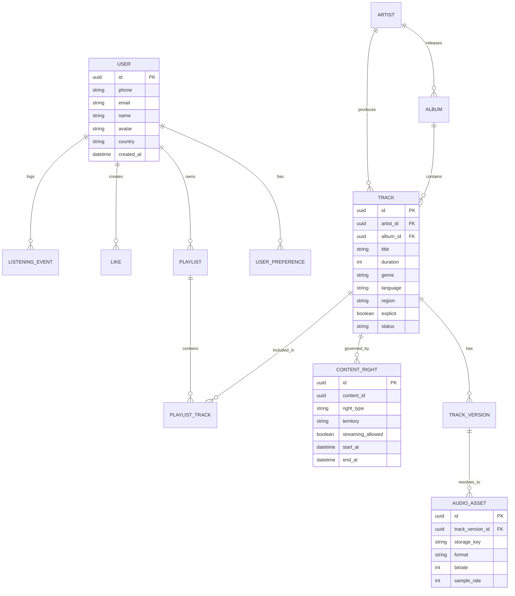
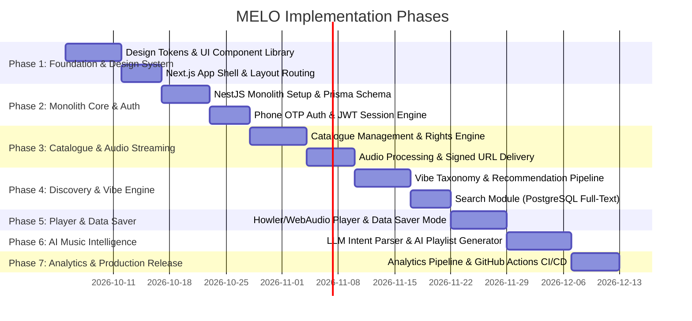

# MELO — Master Implementation Plan & Architectural Blueprint

> **Product:** MELO — Find Your Vibe  
> **Target Audience:** University students and young music listeners in Nigeria & across Africa  
> **Source PRD:** [MELO — MASTER PRD v1.md](file:///c:/Users/innoc/OneDrive/Documents/MELO%20-%20Find%20Your%20Vibe/docs/MELO%20%E2%80%94%20MASTER%20PRD%20v1.md)  
> **Architecture Pattern:** Modular Monolith (Next.js Frontend + Node.js/NestJS Backend + PostgreSQL + Redis)  

---

## 1. Architectural Decisions & System Topology

### 1.1 Architecture Overview
Melo is built as a **Modular Monolith** to maximize development velocity, maintain clean domain boundaries, and avoid premature microservices overhead.



### 1.2 Tech Stack Specification

| Domain | Technology / Tool | Rationale |
| :--- | :--- | :--- |
| **Frontend Framework** | Next.js 14+ (App Router) | Server-side rendering for fast initial loads, excellent PWA support, optimized image/asset loading. |
| **Styling & UI Systems** | Tailwind CSS + Vanilla CSS Variables | Rapid design system iteration with dark-mode first glassmorphism and fine-grained micro-animations. |
| **State & Audio Player** | Zustand + Howler.js / Custom HTML Audio API | Lightweight state management for persistent audio playback across page routes. |
| **Backend Framework** | NestJS (TypeScript) / Fastify | Strict module encapsulation, strong TypeScript type safety, high HTTP throughput. |
| **Primary Database** | PostgreSQL + Prisma ORM | Relational integrity for user data, playlists, tracks, rights, and PostgreSQL native Trigram Search. |
| **Caching & In-Memory** | Redis | Session state, rate limiting, Home feed caching, search suggestions, temporary playback tokens. |
| **Media Delivery** | AWS S3 / Cloudflare R2 + CDN | Low-latency audio streaming via short-lived signed URLs. |
| **AI Orchestration** | LangChain / Direct Provider SDK | Structured output parsing (JSON schema), grounding prompts, candidate ranker tools. |

---

## 2. Design System & Aesthetics Guidelines

Melo's design identity is **vibrant, dark-themed, African-inspired, warm, and hyper-modern**. It avoids the flat utility look of generic streaming apps.

### 2.1 Color Palette & Tokens

```css
:root {
  /* Backgrounds */
  --bg-base: #121212;
  --bg-surface: #1E1E1E;
  --bg-surface-elevated: #282828;
  --bg-glass: rgba(30, 30, 30, 0.75);

  /* Primary & Accents */
  --color-primary: #1DB95D;       /* Energetic Melo Green */
  --color-primary-hover: #1ED760;
  --color-ember: #FF5722;         /* African Sunset Ember */
  --color-gold: #FFC107;          /* Highlife Gold */
  --color-teal: #00E5FF;          /* Afro-Teal Accent */

  /* Text & Neutral */
  --text-primary: #FFFFFF;
  --text-secondary: #B3B3B3;
  --text-muted: #727272;
  --border-subtle: rgba(255, 255, 255, 0.1);

  /* Micro-Interactions */
  --transition-fast: 0.15s ease-out;
  --transition-smooth: 0.3s cubic-bezier(0.4, 0, 0.2, 1);
  --shadow-glass: 0 8px 32px 0 rgba(0, 0, 0, 0.37);
}
```

### 2.2 Core UI Components Specification
1. **Vibe Pills**: Interactive, multi-layered tag pills (Mood, Activity, Context, African Vibe) with ambient glow on selection.
2. **Persistent Player Bar**: Fixed bottom bar featuring track progress, metadata, artwork glow, queue popover, and Data Saver quick toggle.
3. **AI Natural Language Bar**: Floating prompt input with predefined African vibe prompt suggestions (*e.g., "Calm Naija study tunes"*).
4. **Data Saver Banner & Controls**: Non-intrusive network quality indicator that alerts users when switching stream quality modes.

---

## 3. Database Schema Blueprint (PostgreSQL / Prisma)



---

## 4. Phased Implementation Roadmap



---

### Phase 1: Design System & UX Shell
- **Goal:** Establish global CSS tokens, dark theme layout, component storybook/preview, and responsive breakpoints (Mobile / Tablet / Desktop).
- **Key Deliverables:**
  - `src/styles/tokens.css` with CSS variables.
  - UI Component Kit: Buttons, Vibe Pills, Cards, Modal Dialogs, Skeleton Loaders.
  - Persistent Layout Shell: Sidebar (Desktop), Bottom Navigation (Mobile), Header with Search Bar.
  - Audio Player UI state machine (Play, Pause, Buffer, Seek, Error, Minimal Mode).

### Phase 2: Core Backend Monolith & Authentication
- **Goal:** Scaffold NestJS application structure, PostgreSQL Prisma models, Redis connection, and Phone OTP auth flow.
- **Key Deliverables:**
  - `modules/auth`: Phone number registration, OTP generation & validation, JWT issuance.
  - `modules/users`: User profile creation, onboarding preference ingestion (favorite artists, genres, vibes).
  - PostgreSQL migrations & seed scripts with mock African music metadata.

### Phase 3: Catalogue, Rights & Audio Delivery Engine
- **Goal:** Build catalogue CRUD, rights verification guardrails, and secure audio streaming signed URLs.
- **Key Deliverables:**
  - `modules/catalogue`: Artist, Album, Track, TrackVersion, AudioAsset API endpoints.
  - `modules/rights`: Pre-playback authorization checker (`CanUserPlayTrack(userId, trackId, territory)`).
  - S3 / Cloudflare R2 integration: Audio processing script (generating Data Saver 64kbps, Balanced 128kbps, High 320kbps MP3/AAC streams) and CloudFront short-lived URL signing.

### Phase 4: Discovery Engine (Home, Vibes & Search)
- **Goal:** Implement core discovery interfaces powered by vibe taxonomy and PostgreSQL trigram full-text search.
- **Key Deliverables:**
  - `modules/vibes`: Mood, Activity, Context, and African Vibe categories (*e.g., "Naija Chill", "Lagos Night", "Sunday Morning"*).
  - `modules/search`: Multi-entity search endpoint for tracks, artists, albums, playlists, and vibes with typo tolerance.
  - Home feed aggregator API (`/api/v1/home`): Contextual greeting, "Your Vibe", "African Spotlight", "Trending in Nigeria".

### Phase 5: Playback Engine & Data Saver Implementation
- **Goal:** Build seamless audio playback experience with client-side state persistence and network-aware data saving.
- **Key Deliverables:**
  - Web Audio player hook (`useMeloPlayer`) with persistent global state.
  - **Data Saver Module (P0 Differentiation)**:
    - User setting for streaming quality (`data_saver`, `balanced`, `high`, `auto`).
    - Network status listener (`navigator.connection`) that automatically downgrades to 64kbps audio stream when network latency spikes.
  - Listening event logger (`/api/v1/events/listen`) logging play, skip, completion rate, and replay events.

### Phase 6: Personalization & Library Management
- **Goal:** Allow users to save music, build custom playlists, and feed behavioral data back into recommendations.
- **Key Deliverables:**
  - `modules/library`: Liked tracks, saved albums, artist follows, and recently played history.
  - `modules/playlists`: Create, edit, reorder, delete, and publish custom playlists.
  - Basic candidate ranking heuristic balancing familiarity (60%) and emerging African artists (40%).

### Phase 7: AI Music Intelligence (AI Search & Playlist Generator)
- **Goal:** Implement natural-language music intent parser and AI playlist generator strictly grounded in the database catalogue.
- **Key Deliverables:**
  - `modules/ai/intent-parser`: Converts queries like *"Give me calm Nigerian songs for studying"* into structured JSON:
    ```json
    {
      "mood": ["calm"],
      "activity": ["study"],
      "region": ["Nigeria"],
      "energy": "low",
      "discovery_level": "medium"
    }
    ```
  - `modules/ai/playlist-generator`: Resolves structured JSON against PostgreSQL track metadata, checks rights eligibility, applies diversity rules, and generates a playable playlist.
  - **AI Safety Rule**: Prevents LLM hallucination by validating every recommended track ID against database truth before returning to UI.

### Phase 8: Beta Release, CI/CD & Production Hardening
- **Goal:** Set up automated testing, CI/CD deployment pipelines, error monitoring, and release gate validation.
- **Key Deliverables:**
  - Unit & Integration tests for Rights, Auth, AI Intent Parser, and Playback Authorization.
  - GitHub Actions workflow (`.github/workflows/ci.yml`) for automated linting, type-checking, and testing.
  - Sentry & LogRocket monitoring setup.
  - Production launch checklist verification.

---

## 5. Next Action Items & Recommendations

> [!TIP]
> **Recommended Immediate Next Step:**
> Proceed with **Phase 1 & Phase 2 Foundation**: Initialize the Next.js App Router workspace, set up the Tailwind CSS design system tokens, and define the Prisma database schema.

> [!NOTE]
> All developments strictly adhere to the pre-development rules defined in section 4.8 (*Never invent catalogue information*) and section 4.9 (*Rights before scale*) of the PRD document.
